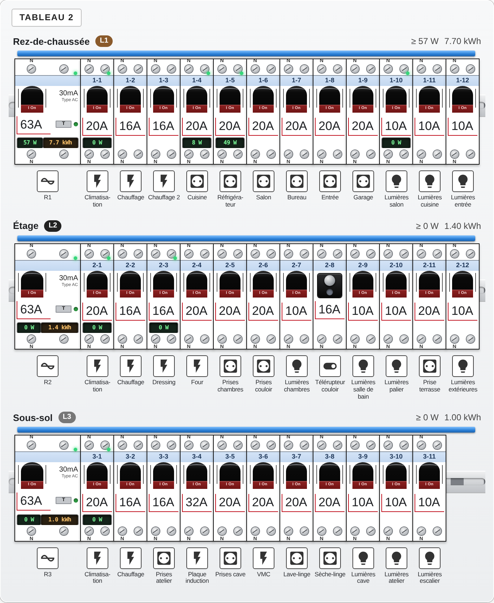
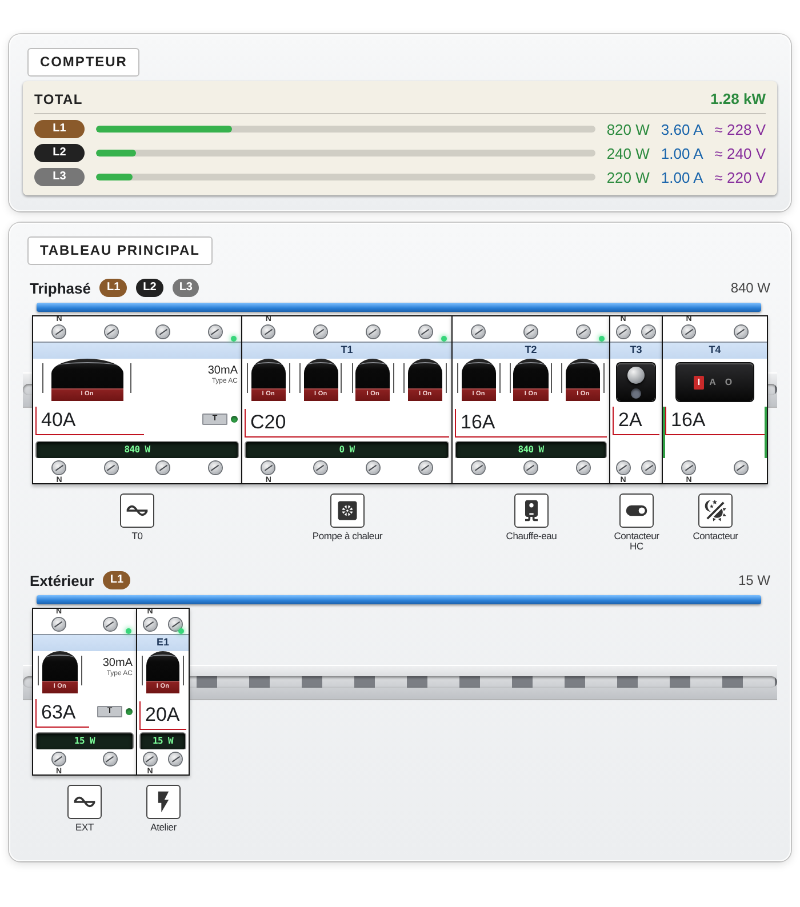
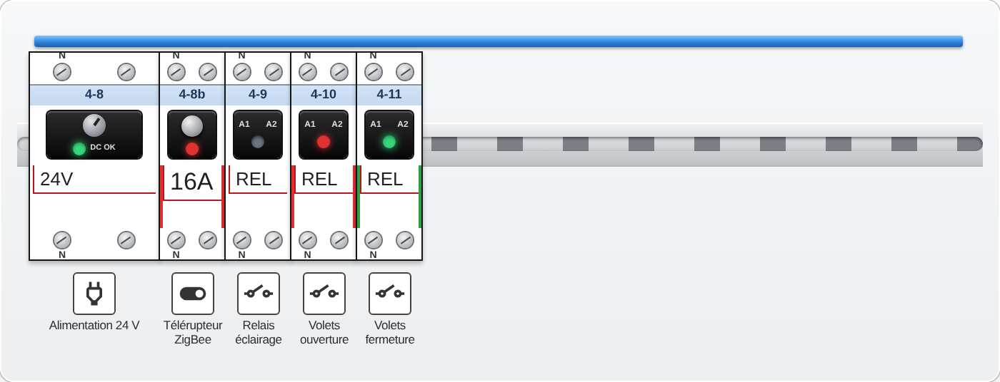
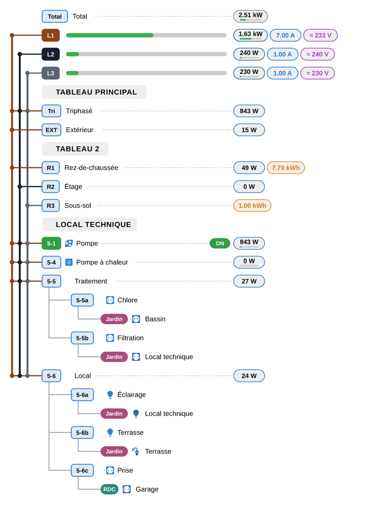

# DIN Panel Card

A Home Assistant Lovelace card that draws a **real modular electrical panel seen from the front**: enclosure, rows, DIN rail, devices whose width is proportional to their number of modules (1, 2, 3, 4…), screw terminals, levers and labels. A one-line **diagram view** is available with one click. Measurements come from your HA entities and update live.

*Une version française de ce document se trouve à la fin / [French version at the bottom](#version-française).*

## Preview

**Panel view**: realistic enclosure, DIN rail, devices at their real width, sensor values coloured by type (W, kWh, A, V).



**Incoming** frame (Total as a plain line, then L1/L2/L3 with a gauge, current and voltage) above the panels:



Power supply, impulse relay and relays (coloured state: green = on, red = off):



**Diagram view** (button at the top of the card): one-line diagram with phase trunks, gauges, measurement bubbles and collapsible zones.



## Installation

### Home Assistant 2026.11 and later — Marketplace

Since 2026.11, HACS is built into Home Assistant under the name **Marketplace** (a standalone HACS install is no longer possible; custom repositories already added in HACS are migrated automatically).

1. *Settings → **Marketplace*** (administrator account). The first time, read the notice and tick the acceptance box.
2. Click **Add from link** and enter: `https://github.com/freddye83/din-panel-card`
3. Approve the GitHub connection (device sign-in: you approve on GitHub, no password is typed in HA; only public information is read).
4. Open the card in the list, then **Install**. The file is placed in `www/community` and is **automatically added as a dashboard resource**.
5. **Reload the browser** (Ctrl+F5), then add the card: *Edit dashboard → Add card → DIN Panel Card* (or `type: custom:din-panel-card` in YAML).

Notes:
- Added repositories are listed on the Marketplace **Custom repositories** page and stay there until uninstalled.
- Updates appear in *Settings → Updates* (checked every 6 h).
- If you manage dashboard resources **in YAML**, the Marketplace cannot add the resource for you: the install dialog shows the exact line to add (type `module`). It is not removed automatically on uninstall.
- If the `www` folder did not exist when HA started, a repair asks you to restart first.

### Before 2026.11 — HACS

*HACS → ⋮ → Custom repositories* → repository URL, category **Dashboard** → install → reload the browser.

### Manual

Copy `dist/din-panel-card.js` to `/config/www/`, then *Settings → Dashboards → ⋮ → Resources* → add `/local/din-panel-card.js` (type **JavaScript module**).

## Quick start

```yaml
type: custom:din-panel-card
title: Electrical panels
sensors:
  total: { entity: sensor.grid_power, max_w: 9000 }
panels:
  - id: main
    label: Main panel
    rows:
      - id: row_1
        label: Ground floor
        phases: [L1]
        modules:
          - { type: differential, id: ID1, amp: 40, mA: 30, class: AC }
          - { type: breaker, id: 1-1, amp: 16, curve: C, usage: socket, label: Sockets, sensor: sensor.sockets_power,
              zones: [ { floor: Ground, room: Living room, sensor: sensor.tv_power } ] }
          - { type: breaker, id: 1-2, amp: 10, usage: light, label: Lights }
```

A complete example using every device type: [`examples/full-example.yaml`](examples/full-example.yaml).

The card is **read-only**: it never calls a service. A click on a device opens its detail sheet (rating, poles, values, zones, protected circuits); a click on a sensor value opens the HA more-info dialog.

## Configuration reference

The configuration is a tree: **card → panels → rows → modules → zones**. Every option is optional unless marked *required*. An absent field produces nothing on screen; an unavailable, unknown or missing sensor shows a greyed `n/a`, never an error.

### Card options

| Option | Type | Default | Description |
|---|---|---|---|
| `type` | string | — *(required)* | Always `custom:din-panel-card`. |
| `panels` | list | — *(required)* | List of [panels](#panels). |
| `title` | string | none | Title shown at the top of the card. |
| `language` | `fr` \| `en` | HA language | Language of the card and of the editor. |
| `view` | `panel` \| `tree` | `panel` | Initial view: `panel` = realistic front view, `tree` = one-line diagram. If set, it **always wins**; if not set, the last view chosen with the toolbar button is remembered per card in the browser. |
| `module_width` | number (px) | `46` | Width of one DIN module in the panel view (30–90 in the editor). Everything scales with it. |
| `modules_per_row` | integer ≥ 1 | auto | Panel view: capacity of a row in DIN modules (a real enclosure: 13, 18, 24…). The rail and enclosure are then exactly `N × module_width` px wide. See [Panel width](#panel-width-modules-per-row). Can be overridden per panel. |
| `max_width` | number (px) | `700` | Diagram view: beyond this width the diagram gets wider (more room for labels) instead of bigger. |
| `collapsed` | `none` \| `zones` \| `rows` \| `panels` | `none` | Diagram view: initial collapse level (zones only, + rows, + panels). |
| `nominal_voltage` | number (V) | `230` | Used to derive a power limit in W from a rating in A (`amp × voltage`, ×3 for 3-pole devices) when `max_w` is not set. |
| `incoming_title` | string | `Arrivée` / `Incoming` | Title of the *Incoming* frame (panel view). Use `""` to hide it. |
| `sensors` | object | none | Incoming measurements, see [sensors](#sensors-incoming-lines). |
| `floors` | map | auto colours | Colours of the floor pills in the diagram: `{ <floor name>: { bg: '#38a169', fg: white } }`. A floor without an entry gets a stable colour generated from its name. |

CSS variables: `--din-panel-phase-l1-color`, `--din-panel-phase-l2-color`, `--din-panel-phase-l3-color` (phase trunk colours; defaults brown / black / grey).

### Sensors (incoming lines)

Optional summary shown as the *Incoming* frame (panel view) and at the head of the diagram (Total and phase heads).

```yaml
sensors:
  total: { entity: sensor.grid_power, current_sensor: sensor.grid_current, max_w: 9000 }
  phases:
    l1: { entity: sensor.power_l1, current_sensor: sensor.current_l1, voltage_sensor: sensor.voltage_l1, max_w: 3000 }
    l2: { entity: sensor.power_l2 }
    l3: { entity: sensor.power_l3 }
```

| Field | Applies to | Description |
|---|---|---|
| `entity` | `total`, `l1`, `l2`, `l3` | Power (W, kW) **or** energy (Wh, kWh) sensor. A sensor reporting amperes is **ignored here** — use `current_sensor` for that. |
| `current_sensor` | same | Current sensor (A, mA), displayed next to `entity`. |
| `voltage_sensor` | same | Voltage sensor (V), displayed next to the others. If omitted and both a power (W/VA) and a current are known, the voltage is **estimated** as U ≈ P / I and shown with `≈`. The estimate is exact only for *apparent* power (VA); with active power (W) it is under-estimated by the power factor, so provide a real `voltage_sensor` when in doubt. Not computed when I < 0.05 A. |
| `max_w` | same | Power limit (W) used for the gauge. Phases without it use `total.max_w ÷ number of phases`, otherwise the most loaded phase. The Total line has no gauge in the panel view. |

Phase keys are `l1`, `l2`, `l3` (case-insensitive). Values of different kinds are shown side by side (W, kWh, A, V), each in its own colour.

### Panels

| Field | Type | Default | Description |
|---|---|---|---|
| `id` | string | `panel_N` | Identifier. |
| `label` | string | none | Panel title (printed on the enclosure; also in the diagram). |
| `modules_per_row` | integer ≥ 1 | card value | Overrides the card's `modules_per_row` for this panel. |
| `rows` | list | `[]` | List of [rows](#rows). |

### Rows

A row is a DIN rail. A differential protects the modules that **follow it in the row**, up to the next differential.

| Field | Type | Default | Description |
|---|---|---|---|
| `id` | string | `row_N` | Identifier (used as the collapse key; not shown on the diagram). |
| `label` | string | none | Row title (panel view header; diagram: shown before the differential's own label, see below). |
| `phases` | list `[L1, L2, L3]` | none | Phases of the row. Inherited by its modules; also connects the diagram lines to the phase trunks. |
| `accent` | CSS colour | blue | Accent colour of the row: the coloured band of its devices (e.g. the *AC* band of differentials) and the id boxes / bubbles of the diagram. A module's own `accent` overrides it. |
| `modules` | list | `[]` | List of [modules](#modules), left to right. |

In the diagram, the line of each differential reads **`[differential id]  row label - differential label`**; a missing label is simply left out (nothing is shown if neither is set).

### Modules

#### Fields

| Field | Type | Default | Description |
|---|---|---|---|
| `type` | string | `breaker` | Device type, see [module types](#module-types). Unknown values become `custom`. |
| `id` | string | `<row>-<n>` | Identifier printed on the device (not on differentials in the panel view). |
| `label` | string | `id` | Label printed on the nameplate below the device. |
| `amp` | number (A) | none | Rating, printed on the device (`16A`). Also the reference of the current gauge and the basis of the default power limit. |
| `curve` | `B` \| `C` \| `D` | none | Trip curve; printed (`C20`) only when set. |
| `mA` | number | none | Differential only: sensitivity (e.g. `30`, `300`). |
| `class` | `AC` \| `A` \| `F` \| `B` | none | Differential only: type. |
| `poles` | 1–4 | type default | Number of poles. Not printed on the device (kept in the detail sheet). One screw per pole (2 minimum: a 1-DIN device without `poles` is drawn with 2 terminals, phase + neutral). The `N` mark is drawn on the first screw except on 3-pole devices. |
| `width` | 1–12 | `poles`, or type default | Width in DIN modules. |
| `usage` | `power` \| `socket` \| `light` \| `other` | `other` | Breakers: colours the nameplate stripe and sets the default icon. |
| `phases` | list | row phases | e.g. `[L1]`, `[L1, L2, L3]`. A breaker on 3 phases defaults to 3 poles. |
| `sensor` | entity | none | Power (W, kW), **energy (Wh, kWh) or current (A, mA)**. The kind is detected from the sensor unit (then its `device_class`, then assumed W). Without `sensor`: sum of the `zones` sensors, then (differential) sum of the protected circuits — shown as `≥` in the detail sheet when partial. |
| `current_sensor` | entity | none | Current sensor (A), displayed **next to** `sensor` when both are set (a second sensor of the same kind as `sensor` is not duplicated). Alone, it is displayed on its own. |
| `voltage_sensor` | entity | none | Voltage sensor (V) used in the detail sheet; lets the card derive I = P/U when there is no current sensor. |
| `state_entity` | entity | none | Read-only state of a lever / relay / impulse relay / power supply ("DC OK") / surge arrester: a `switch`, `binary_sensor` or **any sensor** (`on/off`, `active/inactive`, `open/closed`, `1/0`, numeric > 0). Coloured green (on) / red (off) on the device and as an ON/OFF pill in the diagram. |
| `output` | string | none | Power supply: printed output (e.g. `24 V DC`). |
| `section` | string/number | none | Cable cross-section in mm², printed in red under the label (e.g. `1.5`). |
| `max_w` | number (W) | `amp × nominal_voltage` (×3 if 3-pole) | Power limit: base of the gauge and of the load LED. |
| `zones` | list | `[]` | Places supplied by this circuit, see [zones](#zones). |
| `icon` | `mdi:…` | by type / usage | Icon on the nameplate and in the diagram (also the default icon of its zones). |
| `accent` | CSS colour | row accent / by usage | Colour of the device band, of the nameplate stripe and of the diagram box. |
| `note` | string | none | Free text shown in the detail sheet. |

#### Module types

| `type` (aliases) | Device | Default poles / width |
|---|---|---|
| `differential` (`rcd`, `diff`) | Residual-current device | 2 poles / width = poles |
| `breaker` (`breaker_1p`, `breaker_2p`, `breaker_3p`, `breaker_4p`, `three_phase`, `tetrapolar`) | Circuit breaker | 1 pole (3 on 3 phases) / width = poles |
| `contactor_daynight` (`daynight`) | Day/night contactor with selector | 1 pole / width 2 |
| `contactor` (`power_contactor`) | Power contactor | 1 pole / width 2 |
| `relay` (`relais`) | Relay (A1/A2 coil, state LED) | 2 poles / width 1 |
| `impulse` (`telerupteur`) | Impulse relay | 2 poles / width 1 |
| `psu` (`alimentation`) | DC power supply | 2 poles / width 2 |
| `surge` (`surge_arrester`) | Surge arrester | 2 poles / width = poles |
| `meter` | Energy meter (LCD) | 2 poles / width 4 |
| `free` | Empty slot | 1 pole / width 1 |
| `custom` | Generic device (any other value) | 1 pole / width 1 |

State colouring (`state_entity`): relay, impulse relay, contactor and day/night contactor get a green (on) / red (off) outline.

### Zones

Places supplied by a circuit. Shown in the hover bubble (panel view), in the detail sheet and as rows under the circuit in the diagram (collapsible).

```yaml
zones:
  - { floor: Ground, room: Kitchen, icon: mdi:stove, sensor: sensor.oven_power }
  - { floor: First, room: Bedroom }
```

| Field | Type | Default | Description |
|---|---|---|---|
| `floor` | string | none | Floor; shown as a coloured pill in the diagram (colour from `floors`). |
| `room` | string | none | Room. |
| `icon` | `mdi:…` | icon of the circuit | Icon shown **between the floor and the room** (diagram) and in front of the text in the hover bubble. Without it, the circuit's icon is used (its `icon`, else the usage icon). |
| `sensor` | entity | none | Power / energy / current sensor of this zone; shown on the row, clickable. A circuit without its own `sensor` shows the sum of its zones. |

A zone can also be a plain string, which is taken as the room name.

## Views

### Panel view
- Devices are drawn at their real width, with terminals, levers and nameplates.
- Value above the identifier: **power (green), energy (amber), current (blue), voltage (violet)**. If a row/differential mixes kinds, one sum per kind is shown side by side (differentials show nothing when empty).
- Load LED: green < 60 %, orange < 90 %, red ≥ 90 %, **blinking red above 100 %**.
- Hover a device: bubble with its icon, title, rating and the list *floor · room* with the icon of each zone.
- Small screens: each row scrolls horizontally, proportions are never distorted. Light/dark themes are followed automatically.

### Diagram view
One-line diagram with **phase trunks** L1/L2/L3 (brown / black / grey), **Total** line (no gauge) and phase heads (gauge + values), **id boxes** followed by the label, **measurement bubbles aligned on the right** with a saturation gauge (`max_w`, else rating × voltage; red above 100 %), circuits attached to the bus of their differential (circuits outside any differential are connected straight to the trunks of their phases), **zones** with a coloured floor pill and icon, and **ON/OFF pills** for devices with a `state_entity`. Dotted guides are drawn only when there is something to show on the right.

A click on a node opens its detail sheet; a click on the Total / a phase / a zone opens its sensor. **Collapse**: every panel title, every row (differential) and every circuit with zones has a clickable chevron (keyboard accessible). The *Expand all* and *Collapse one level* buttons (zones, then rows, then panels) act on the whole card.

### Panel width (modules per row)

`modules_per_row` sets the capacity of a row in DIN modules. The rail and the enclosure are then exactly `N × module_width` px wide, and the *Incoming* frame uses the same width. If a row contains more than N DIN modules (sum of `width`), it continues on an **extra rail**; a module wider than N sits alone on its rail. On small screens the row scrolls horizontally.

## Development

```bash
npm install
npm run build     # typecheck + minified bundle -> dist/din-panel-card.js (version from package.json)
npm test          # configuration normalisation, sensors, aggregation
npm run smoke     # render in jsdom
npm run regress   # jsdom regression assertions (diagram, remembered view, language, LED, keyboard, editor)
```

Layout: `src/config.ts` (normalisation), `src/components/` (panel, row, module, details, `diagram.ts`, `modules/faces.ts` = look of each type), `src/editor.ts` (visual editor), `src/styles.ts`, `src/utils/`.

Each new version bumps `version` in `package.json`; it is printed in the browser console on load. See [CHANGELOG.md](CHANGELOG.md) (in French). Current version: **1.17.4**.

---

# Version française

Carte Lovelace pour Home Assistant qui dessine un **vrai tableau électrique modulaire vu de face** : coffret, rangées, rail DIN, appareils de largeur proportionnelle à leur nombre de modules (1, 2, 3, 4…), bornes à vis, leviers, plaquettes de repérage. Une vue **schéma unifilaire** est disponible en un clic. Les mesures viennent de tes entités HA et se mettent à jour en direct. Voir les captures d'écran dans la section *Preview* ci-dessus.

## Installation

### Home Assistant 2026.11 et plus — Marketplace

Depuis la 2026.11, HACS est intégré à Home Assistant sous le nom de **Marketplace** (une installation séparée de HACS n'est plus possible ; les dépôts personnalisés déjà ajoutés dans HACS sont migrés automatiquement).

1. *Paramètres → **Marketplace*** (compte administrateur). À la première ouverture, lire l'avertissement et cocher la case d'acceptation.
2. Cliquer sur **Ajouter depuis un lien** et saisir : `https://github.com/freddye83/din-panel-card`
3. Valider la connexion GitHub (connexion par appareil : tu approuves sur GitHub, aucun mot de passe n'est saisi dans HA ; seules les infos publiques sont lues).
4. Ouvrir la carte dans la liste puis **Installer**. Le fichier est placé dans `www/community` et ajouté **automatiquement comme ressource** du tableau de bord.
5. **Recharger le navigateur** (Ctrl+F5), puis ajouter la carte : *Modifier le tableau de bord → Ajouter une carte → DIN Panel Card* (ou `type: custom:din-panel-card` en YAML).

Notes :
- Les dépôts ajoutés se retrouvent dans la page **Dépôts personnalisés** du Marketplace ; ils y restent tant qu'ils ne sont pas désinstallés.
- Les mises à jour apparaissent dans *Paramètres → Mises à jour* (vérification toutes les 6 h).
- Si tu gères les ressources du tableau de bord **en YAML**, le Marketplace ne peut pas l'ajouter : la fenêtre d'installation affiche la ligne exacte à ajouter (type `module`). Elle ne sera pas retirée automatiquement à la désinstallation.
- Si le dossier `www` n'existait pas au démarrage de HA, une réparation demande d'abord un redémarrage.

### Avant la 2026.11 — HACS

*HACS → ⋮ → Dépôts personnalisés* → URL du dépôt, catégorie **Dashboard** → installer → recharger le navigateur.

### Manuelle

Copier `dist/din-panel-card.js` dans `/config/www/`, puis *Paramètres → Tableaux de bord → ⋮ → Ressources* → ajouter `/local/din-panel-card.js` (type **Module JavaScript**).

## Démarrage rapide

```yaml
type: custom:din-panel-card
title: Tableaux électriques
sensors:
  total: { entity: sensor.puissance_totale, max_w: 9000 }
panels:
  - id: principal
    label: Tableau principal
    rows:
      - id: row_1
        label: RDC
        phases: [L1]
        modules:
          - { type: differential, id: ID1, amp: 40, mA: 30, class: AC }
          - { type: breaker, id: 1-1, amp: 16, curve: C, usage: socket, label: Prises, sensor: sensor.prises_puissance,
              zones: [ { floor: RDC, room: Salon, sensor: sensor.tv_puissance } ] }
          - { type: breaker, id: 1-2, amp: 10, usage: light, label: Lumières }
```

Exemple complet avec tous les types d'appareils : [`examples/full-example.yaml`](examples/full-example.yaml).

La carte est **en lecture seule** : elle n'appelle aucun service. Un clic sur un appareil ouvre sa fiche (calibre, pôles, valeurs, zones, circuits protégés) ; un clic sur une valeur de capteur ouvre la fenêtre HA du capteur.

## Référence de configuration

La configuration est un arbre : **carte → tableaux → rangées → modules → zones**. Toutes les options sont facultatives sauf mention *(obligatoire)*. Un champ absent ne produit rien à l'écran ; un capteur indisponible, inconnu ou absent affiche un `n/d` grisé, jamais d'erreur.

### Options de la carte

| Option | Type | Défaut | Description |
|---|---|---|---|
| `type` | texte | — *(obligatoire)* | Toujours `custom:din-panel-card`. |
| `panels` | liste | — *(obligatoire)* | Liste des [tableaux](#tableaux-panels). |
| `title` | texte | aucun | Titre affiché en haut de la carte. |
| `language` | `fr` \| `en` | langue de HA | Langue de la carte et de l'éditeur. |
| `view` | `panel` \| `tree` | `panel` | Vue initiale : `panel` = vue de face réaliste, `tree` = schéma unifilaire. Si renseignée, elle est **toujours prioritaire** ; sinon la dernière vue choisie avec le bouton est mémorisée par carte dans le navigateur. |
| `module_width` | nombre (px) | `46` | Largeur d'un module DIN en vue tableau (30–90 dans l'éditeur). Tout s'adapte à cette valeur. |
| `modules_per_row` | entier ≥ 1 | auto | Vue tableau : capacité d'une rangée en modules DIN (un vrai coffret : 13, 18, 24…). Le rail et le coffret font alors exactement `N × module_width` px. Voir [Largeur du tableau](#largeur-du-tableau-modules-par-rangée). Peut être surchargée par tableau. |
| `max_width` | nombre (px) | `700` | Vue schéma : au-delà de cette largeur, le schéma s'élargit (plus de place pour les libellés) au lieu de grossir. |
| `collapsed` | `none` \| `zones` \| `rows` \| `panels` | `none` | Vue schéma : niveau de repli initial (zones seules, + rangées, + tableaux). |
| `nominal_voltage` | nombre (V) | `230` | Sert à déduire une limite en W d'un calibre en A (`amp × tension`, ×3 si tripolaire) quand `max_w` n'est pas renseigné. |
| `incoming_title` | texte | `Arrivée` / `Incoming` | Titre du cadre *Arrivée* (vue tableau). `""` pour le masquer. |
| `sensors` | objet | aucun | Mesures d'arrivée, voir [capteurs](#capteurs-lignes-darrivée). |
| `floors` | map | couleurs auto | Couleurs des pastilles d'étage du schéma : `{ <nom d'étage>: { bg: '#38a169', fg: white } }`. Un étage sans entrée reçoit une couleur stable générée depuis son nom. |

Variables CSS : `--din-panel-phase-l1-color`, `--din-panel-phase-l2-color`, `--din-panel-phase-l3-color` (couleurs des troncs de phases ; défaut marron / noir / gris).

### Capteurs (lignes d'arrivée)

Synthèse facultative affichée dans le cadre *Arrivée* (vue tableau) et en tête du schéma (Total et têtes de phases).

```yaml
sensors:
  total: { entity: sensor.puissance_totale, current_sensor: sensor.intensite_totale, max_w: 9000 }
  phases:
    l1: { entity: sensor.puissance_l1, current_sensor: sensor.intensite_l1, voltage_sensor: sensor.tension_l1, max_w: 3000 }
    l2: { entity: sensor.puissance_l2 }
    l3: { entity: sensor.puissance_l3 }
```

| Champ | S'applique à | Description |
|---|---|---|
| `entity` | `total`, `l1`, `l2`, `l3` | Capteur de puissance (W, kW) **ou** d'énergie (Wh, kWh). Un capteur en ampères y est **ignoré** — utiliser `current_sensor`. |
| `current_sensor` | idem | Capteur d'intensité (A, mA), affiché à côté de `entity`. |
| `voltage_sensor` | idem | Capteur de tension (V), affiché à côté des autres. Sans lui, si une puissance (W/VA) et une intensité sont connues, la tension est **estimée** par U ≈ P / I et affichée avec `≈`. L'estimation n'est exacte qu'avec une puissance *apparente* (VA) ; en W actifs elle est sous-estimée du facteur de puissance : renseigner un vrai `voltage_sensor` en cas de doute. Non calculée si I < 0,05 A. |
| `max_w` | idem | Limite de puissance (W) de la jauge. Pour une phase sans valeur : `total.max_w ÷ nombre de phases`, à défaut la phase la plus chargée. La ligne Total n'a pas de jauge en vue tableau. |

Les clés de phases sont `l1`, `l2`, `l3` (casse indifférente). Les valeurs de types différents sont affichées côte à côte (W, kWh, A, V), chacune dans sa couleur.

### Tableaux (`panels`)

| Champ | Type | Défaut | Description |
|---|---|---|---|
| `id` | texte | `panel_N` | Identifiant. |
| `label` | texte | aucun | Titre du tableau (imprimé sur le coffret ; aussi dans le schéma). |
| `modules_per_row` | entier ≥ 1 | valeur de la carte | Remplace le `modules_per_row` de la carte pour ce tableau. |
| `rows` | liste | `[]` | Liste des [rangées](#rangées-rows). |

### Rangées (`rows`)

Une rangée est un rail DIN. Un différentiel protège les modules qui **le suivent dans la rangée**, jusqu'au prochain différentiel.

| Champ | Type | Défaut | Description |
|---|---|---|---|
| `id` | texte | `row_N` | Identifiant (sert de clé de repli ; non affiché dans le schéma). |
| `label` | texte | aucun | Titre de la rangée (en-tête en vue tableau ; schéma : affiché avant le libellé du différentiel, voir ci-dessous). |
| `phases` | liste `[L1, L2, L3]` | aucune | Phases de la rangée. Héritées par ses modules ; relient aussi les lignes du schéma aux troncs de phases. |
| `accent` | couleur CSS | bleu | Couleur d'accent de la rangée : bandeau coloré de ses appareils (ex. bandeau *AC* des différentiels) et boîtes / pastilles du schéma. L'`accent` propre d'un module est prioritaire. |
| `modules` | liste | `[]` | Liste des [modules](#modules-1), de gauche à droite. |

Dans le schéma, la ligne de chaque différentiel s'écrit **`[id du différentiel]  libellé rangée - libellé différentiel`** ; un libellé absent est simplement omis (rien n'est affiché si aucun n'est renseigné).

### Modules

#### Champs

| Champ | Type | Défaut | Description |
|---|---|---|---|
| `type` | texte | `breaker` | Type d'appareil, voir [types de modules](#types-de-modules). Une valeur inconnue devient `custom`. |
| `id` | texte | `<rangée>-<n>` | Identifiant imprimé sur l'appareil (pas sur les différentiels en vue tableau). |
| `label` | texte | `id` | Libellé de la plaquette sous l'appareil. |
| `amp` | nombre (A) | aucun | Calibre, imprimé sur l'appareil (`16A`). Sert aussi de référence à la jauge d'intensité et de base à la limite de puissance par défaut. |
| `curve` | `B` \| `C` \| `D` | aucune | Courbe de déclenchement ; imprimée (`C20`) seulement si renseignée. |
| `mA` | nombre | aucun | Différentiel : sensibilité (ex. `30`, `300`). |
| `class` | `AC` \| `A` \| `F` \| `B` | aucune | Différentiel : type. |
| `poles` | 1–4 | défaut du type | Nombre de pôles. Non imprimé sur l'appareil (conservé dans la fiche). Une vis par pôle (2 minimum : un appareil 1 DIN sans `poles` a 2 bornes, phase + neutre). Le repère `N` est sur la première vis, sauf sur un 3 pôles. |
| `width` | 1–12 | `poles`, ou défaut du type | Largeur en modules DIN. |
| `usage` | `power` \| `socket` \| `light` \| `other` | `other` | Disjoncteurs : colore le liseré de la plaquette et fixe l'icône par défaut. |
| `phases` | liste | phases de la rangée | ex. `[L1]`, `[L1, L2, L3]`. Un disjoncteur sur 3 phases a 3 pôles par défaut. |
| `sensor` | entité | aucun | Puissance (W, kW), **énergie (Wh, kWh) ou intensité (A, mA)**. Le type est détecté par l'unité du capteur (à défaut sa `device_class`, à défaut des watts). Sans `sensor` : somme des capteurs des `zones`, puis (différentiel) somme des circuits protégés — signalée `≥` dans la fiche si partielle. |
| `current_sensor` | entité | aucun | Capteur d'intensité (A), affiché **à côté** de `sensor` si les deux sont renseignés (un second capteur du même type que `sensor` n'est pas dupliqué). Seul, il est affiché seul. |
| `voltage_sensor` | entité | aucun | Capteur de tension (V) utilisé dans la fiche ; permet de déduire I = P/U en l'absence de capteur d'intensité. |
| `state_entity` | entité | aucune | État en lecture seule d'un levier / relais / télérupteur / alimentation (« DC OK ») / parafoudre : `switch`, `binary_sensor` ou **n'importe quel capteur** (`on/off`, `active/inactive`, `open/closed`, `1/0`, valeur numérique > 0). Coloré vert (on) / rouge (off) sur l'appareil et en pastille ON/OFF dans le schéma. |
| `output` | texte | aucun | Alimentation : sortie imprimée (ex. `24 V DC`). |
| `section` | texte/nombre | aucun | Section du câble en mm², imprimée en rouge sous le libellé (ex. `1.5`). |
| `max_w` | nombre (W) | `amp × tension nominale` (×3 si tripolaire) | Limite de puissance : base de la jauge et de la LED de charge. |
| `zones` | liste | `[]` | Lieux alimentés par ce circuit, voir [zones](#zones-1). |
| `icon` | `mdi:…` | selon type / usage | Icône de la plaquette et du schéma (c'est aussi l'icône par défaut de ses zones). |
| `accent` | couleur CSS | accent de la rangée / selon l'usage | Couleur du bandeau de l'appareil, du liseré de la plaquette et de la boîte du schéma. |
| `note` | texte | aucun | Texte libre affiché dans la fiche. |

#### Types de modules

| `type` (alias) | Appareil | Pôles / largeur par défaut |
|---|---|---|
| `differential` (`rcd`, `diff`) | Interrupteur différentiel | 2 pôles / largeur = pôles |
| `breaker` (`breaker_1p`, `breaker_2p`, `breaker_3p`, `breaker_4p`, `three_phase`, `tetrapolar`) | Disjoncteur | 1 pôle (3 sur 3 phases) / largeur = pôles |
| `contactor_daynight` (`daynight`) | Contacteur jour/nuit avec sélecteur | 1 pôle / largeur 2 |
| `contactor` (`power_contactor`) | Contacteur de puissance | 1 pôle / largeur 2 |
| `relay` (`relais`) | Relais (bobine A1/A2, voyant d'état) | 2 pôles / largeur 1 |
| `impulse` (`telerupteur`) | Télérupteur | 2 pôles / largeur 1 |
| `psu` (`alimentation`) | Alimentation DC | 2 pôles / largeur 2 |
| `surge` (`surge_arrester`) | Parafoudre | 2 pôles / largeur = pôles |
| `meter` | Compteur d'énergie (LCD) | 2 pôles / largeur 4 |
| `free` | Emplacement vide | 1 pôle / largeur 1 |
| `custom` | Appareil générique (toute autre valeur) | 1 pôle / largeur 1 |

Coloration d'état (`state_entity`) : relais, télérupteur, contacteur et contacteur jour/nuit prennent un liseré vert (on) / rouge (off).

### Zones

Lieux alimentés par un circuit. Affichés dans la bulle au survol (vue tableau), dans la fiche et en lignes sous le circuit dans le schéma (repliables).

```yaml
zones:
  - { floor: RDC, room: Cuisine, icon: mdi:stove, sensor: sensor.four_puissance }
  - { floor: Étage, room: Chambre }
```

| Champ | Type | Défaut | Description |
|---|---|---|---|
| `floor` | texte | aucun | Étage ; pastille colorée dans le schéma (couleur de `floors`). |
| `room` | texte | aucune | Pièce. |
| `icon` | `mdi:…` | icône du circuit | Icône affichée **entre l'étage et la pièce** (schéma) et devant le texte dans la bulle au survol. À défaut, l'icône du circuit est utilisée (son `icon`, sinon l'icône de l'usage). |
| `sensor` | entité | aucun | Capteur de puissance / énergie / intensité de cette zone ; affiché sur la ligne, cliquable. Un circuit sans `sensor` propre affiche la somme de ses zones. |

Une zone peut aussi être une simple chaîne, prise comme nom de pièce.

## Vues

### Vue tableau
- Les appareils sont dessinés à leur largeur réelle, avec bornes, leviers et plaquettes.
- Valeur au-dessus de l'identifiant : **puissance (vert), énergie (ambre), intensité (bleu), tension (violet)**. Si une rangée / un différentiel mélange les types, une somme par type est affichée côte à côte (un différentiel sans valeur n'affiche rien).
- LED de charge : verte < 60 %, orange < 90 %, rouge ≥ 90 %, **rouge clignotante au-delà de 100 %**.
- Survol d'un appareil : bulle avec son icône, son titre, son calibre et la liste *étage · pièce* avec l'icône de chaque zone.
- Petits écrans : chaque rangée défile horizontalement, les proportions ne sont jamais déformées. Thèmes clair/sombre suivis automatiquement.

### Vue schéma
Schéma unifilaire avec **troncs de phases** L1/L2/L3 (marron / noir / gris), ligne **Total** (sans jauge) et têtes de phases (jauge + valeurs), **boîtes d'identifiant** suivies du libellé, **pastilles de mesure alignées à droite** avec jauge de saturation (`max_w`, sinon calibre × tension ; rouge au-delà de 100 %), circuits rattachés au bus de leur différentiel (les circuits hors différentiel sont reliés directement aux troncs de leurs phases), **zones** avec pastille d'étage colorée et icône, et **pastilles ON/OFF** pour les appareils ayant un `state_entity`. Les pointillés ne sont tracés que s'il y a quelque chose à afficher à droite.

Un clic sur un nœud ouvre sa fiche ; un clic sur le Total / une phase / une zone ouvre son capteur. **Repli** : chaque titre de tableau, chaque rangée (différentiel) et chaque circuit possédant des zones a un chevron cliquable (accessible au clavier). Les boutons « Tout déplier » et « Replier un niveau » (zones, puis rangées, puis tableaux) agissent sur toute la carte.

### Largeur du tableau (modules par rangée)

`modules_per_row` fixe la capacité d'une rangée en modules DIN. Le rail et le coffret font alors exactement `N × module_width` px de large, et le cadre *Arrivée* prend la même largeur. Si une rangée contient plus de N modules DIN (somme des `width`), elle continue sur un **rail supplémentaire** ; un module plus large que N occupe seul son rail. Sur petit écran la rangée défile horizontalement.

## Développement

```bash
npm install
npm run build     # typecheck + bundle minifié -> dist/din-panel-card.js (la version vient de package.json)
npm test          # normalisation de la configuration, capteurs, agrégats
npm run smoke     # rendu dans jsdom
npm run regress   # assertions de non-régression jsdom (schéma, vue mémorisée, langue, LED, clavier, éditeur)
```

Structure : `src/config.ts` (normalisation), `src/components/` (panel, row, module, détails, `diagram.ts`, `modules/faces.ts` = rendu de chaque type), `src/editor.ts` (éditeur visuel), `src/styles.ts`, `src/utils/`.

Chaque nouvelle version incrémente `version` dans `package.json` ; elle est affichée dans la console du navigateur au chargement. Voir [CHANGELOG.md](CHANGELOG.md). Version actuelle : **1.17.4**.
